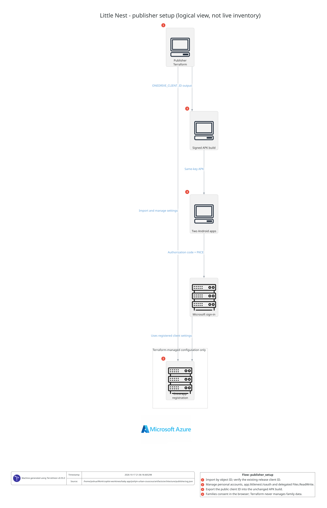
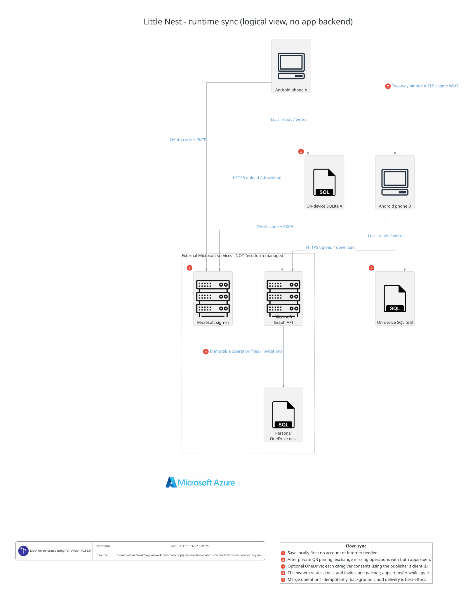

# Terraform and architecture views

Little Nest remains **backend-free**. Terraform adopts the publisher's existing
Microsoft Entra application registration for optional OneDrive sign-in.
It does not provision Azure compute, storage, networking or a database.
There is no Azure subscription requirement for this configuration; the publisher
needs an Entra directory and permission to manage the registration.

## What Terraform owns

[`infra/`](../infra/) manages one existing application with:

- Personal Microsoft accounts only and access-token version 2.
- Native public-client redirect **`app.littlenest:/oauth`**, matching the Android
  AppAuth authorization-code/PKCE flow.
- Microsoft Graph **delegated `Files.ReadWrite`**; no application roles or client
  secret. `openid` and `offline_access` remain runtime sign-in scopes.
- A public `onedrive_client_id` output for the existing APK build.

The Microsoft Graph provider is intentional. AzureAD provider 3.10.0 rejects
the app's valid hostless native redirect during Terraform validation. Changing
it to `app.littlenest://oauth` would change the OAuth callback. The pinned
`microsoft/msgraph` provider configures the existing URI directly through the
stable Graph API instead, without changing Android or creating a shell-script
provisioner.

Terraform manages the name, audience, API token version, native redirect list
and requested API permission list. **Those lists are authoritative:** an apply
can remove other native redirects or requested API permissions. Review any
such changes before approval. Branding, privacy/terms links, owners, publisher
verification and consent grants remain outside this configuration. Do not add
client credentials to this public mobile application.

Phones, SQLite records, QR pairing, device keys, personal OneDrive folders,
invitations, tokens and consent remain app/user-managed. No personal account
or family data belongs in Terraform variables, plans, state or diagrams.
OneDrive retains Microsoft's normal storage protections, not Little Nest
end-to-end encryption.

## Adopt the existing registration

Prerequisites: Terraform 1.7+ (CI uses 1.16.6), Azure CLI and access to the
**publisher's owning Entra directory**. An application owner with the appropriate
directory policy/permissions can manage it; otherwise ask the directory
administrator for the needed application-management access. Do not grant
caregivers directory administration. See Microsoft's
[provider authentication and permission guidance](https://registry.terraform.io/providers/microsoft/msgraph/latest/docs/guides/service_principal_configuration).

1. Find the registration in [Entra app registrations](https://entra.microsoft.com/#view/Microsoft_AAD_RegisteredApps/ApplicationsListBlade).
   Record its **Directory (tenant) ID**, application **Object ID** and
   **Application (client) ID**. The object ID is not the client ID and not the
   enterprise application's service-principal object ID. Check the client ID
   against the configuration used for existing release builds.
2. Sign into that directory, without requiring an Azure subscription:

   ```bash
   az login --tenant YOUR-DIRECTORY-TENANT-ID --allow-no-subscriptions
   ```

3. From the repository root, create a private variables file and replace all
   three synthetic example UUIDs with the confirmed IDs:

   ```bash
   cp infra/terraform.tfvars.example infra/terraform.tfvars
   chmod 600 infra/terraform.tfvars
   ```

4. Initialize, validate and review the import/update plan:

   ```bash
   umask 077
   terraform -chdir=infra init
   terraform -chdir=infra validate
   terraform -chdir=infra plan -out=adopt.tfplan
   ```

   The checked-in import block adopts `/applications/<object-id>`.
   A read of that same existing object verifies the expected client ID before
   changes, and fails if the object cannot be found. The registration has
   `prevent_destroy`, plus a client-ID postcondition. A normal first plan imports
   **one application**, with no application creation, destruction or replacement.
   It may update mismatched settings. **Stop** if the plan selects the wrong
   application, adds a new registration, destroys/replaces one, or removes
   settings that still serve another client.

5. Only after reviewing the plan, apply that saved plan:

   ```bash
   terraform -chdir=infra apply adopt.tfplan
   terraform -chdir=infra plan -detailed-exitcode
   ```

   The follow-up plan should return **0** (no changes); **2** means remaining
   changes, and **1** is an error. Keep the import block: it is harmless once the
   resource is in state and makes adoption explicit in a fresh workspace.
   Do not remove `prevent_destroy` to work around an unexpected plan.

6. Pass the unchanged public client ID to the normal signed release build:

   ```bash
   export ONEDRIVE_CLIENT_ID="$(terraform -chdir=infra output -raw onedrive_client_id)"
   bash scripts/build-apk.sh
   ```

   Export it only after a successful apply. This does not publish or configure
   an APK automatically. Follow [the release procedure](Releases.md) when
   shipping an app build and complete the
   [real-account/two-phone acceptance](Sync-Setup.md#two-phone-acceptance-before-relying-on-sync).

If there is no existing registration, do not invent an ID, remove the import
guard or create a replacement identity for already distributed builds. Confirm
the correct tenant/registration first. If OneDrive has never been configured,
complete the [publisher registration setup](Sync-Setup.md#maintainer-register-microsoft-sign-in-once)
once, then adopt it.

### State and credentials

Local state is the deliberately small initial setup for a single maintainer.
It is ignored by Git, along with `.terraform/`, variable files, saved
`*.tfplan` plans and crash logs. The provider dependency lock file **is**
committed. Use `umask 077`, store state/backups on an encrypted private disk,
and never upload state, saved plans or raw Graph responses as CI artifacts.
Treat them as private even though no client secret is created.

Preserve and securely back up state; run only one operation at a time against
it. Before multiple maintainers or automated applies, choose an encrypted,
access-controlled remote backend with state locking and migrate using
`terraform init -migrate-state`. That backend and deployment identity are not
silently provisioned here. No credentials, deployment identity or automatic
apply are configured in GitHub Actions.

## Architecture views generated with TerraVision

These views were rendered through **TerraVision's local MCP `render_graph`
tool**, not drawn from a live cloud scan or a Terraform plan.

### Publisher setup



### Runtime sync



The numbered steps and arrow labels show how the parts interact. Two-way
exchanges use a single labeled arrow. Local Wi-Fi requires both apps open;
OneDrive permits different connection times, with best-effort Android background
jobs. Both merge the same operation IDs.

These are **logical views**, not deployment inventories. TerraVision's Azure
icon vocabulary is used for generic client, service, database and grouping
symbols: a server icon is not an Azure VM, a database icon is not Azure SQL,
and a grouping box is not an Azure resource group. Microsoft sign-in, Graph
and personal OneDrive are external services, not resources deployed by this
Terraform. Only the Entra registration settings are managed here.

TerraVision's Terraform-to-diagram path targets AWS, AzureRM and GCP resources;
this stack uses the generic Microsoft Graph provider instead. Feeding that plan
to TerraVision would not describe the Android/OneDrive system. The reviewed,
checked-in `*.view.json` sources explicitly include app-managed and external
parts without introducing fake Terraform resources just to draw icons.

### Regenerate the views

Install Python 3.12, Git and Graphviz (`dot`, `neato`, `gvpr`) through your normal
package manager, then use an isolated environment from the repository root:

```bash
python3.12 -m venv artifacts/architecture-tools
source artifacts/architecture-tools/bin/activate
python -m pip install -r tooling/infra-requirements.txt
python scripts/render-architecture.py

# Refresh the portable checked-in previews after reviewing the output:
cp artifacts/architecture/publisher.dot.svg docs/architecture/publisher.svg
cp artifacts/architecture/sync.dot.svg docs/architecture/sync.svg
```

The renderer starts a local stdio MCP server, calls `diagram_guide` and renders
both views. No cloud credentials, AI model or remote diagram service is needed.
Warnings or failed renders fail explicitly. SVGs embed their icons; PNG,
editable draw.io and graph/annotation sources remain in ignored
`artifacts/architecture/`. Review diagram changes alongside infrastructure or
sync changes.

To connect the same installed server to your MCP client, add a server using
command `terravision` and arguments
`["mcp", "--output-dir", "/absolute/path/to/this/worktree/artifacts/architecture"]`.
Use the executable's full path if your client does not inherit the virtualenv
PATH. No global MCP configuration is changed by this repository.
See [TerraVision's MCP setup](https://github.com/patrickchugh/terravision/blob/v0.55.0/docs/mcp-server.md).

## Credential-free checks

```bash
terraform -chdir=infra fmt -check -recursive
terraform -chdir=infra init -backend=false -input=false -lockfile=readonly
terraform -chdir=infra validate
terraform -chdir=infra test -no-color
```

Tests use a mocked provider and resource/data overrides, including the import
path, personal-account configuration, the exact Android callback, delegated-only
Graph permissions, client-ID continuity and invalid IDs. They do not contact
Microsoft or prove a live import, consent or real-account sync.

The **Infrastructure checks** workflow runs these checks on infrastructure/view
pushes and pull requests. A separate credential-free job regenerates the views
through MCP and uploads the generated diagrams, never a Terraform state or plan.
It does not deploy infrastructure or publish an Android release.
