# Screenshots

Little Nest's "Woven day" design, with the 1.12 illustrated nursery additions
on Today, Plan, Family, first use and activity tiles. Other views retain their
existing screenshots. Every screenshot uses **synthetic demo data
only**: a baby called Ada, two caregivers called Sam and Alex, and two weeks of
made-up feeds, sleep, nappies and growth measurements. Select an image to see it
full size.

## Light (day)

| Today | Activity tiles | Running timer |
|:---:|:---:|:---:|
| [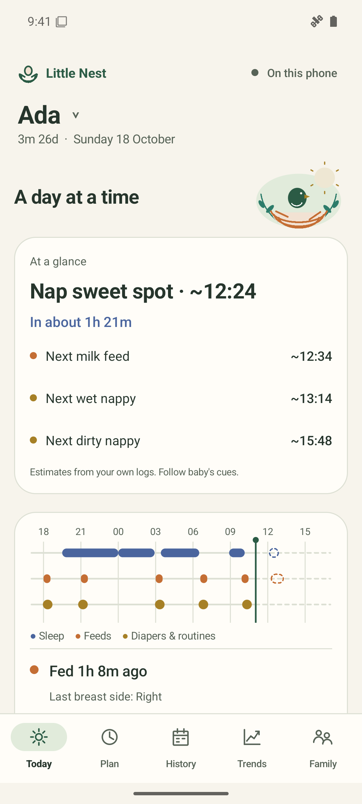](../docs/screenshots/today.png) | [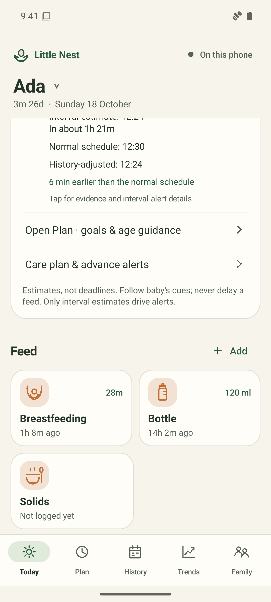](../docs/screenshots/today-tiles.png) | [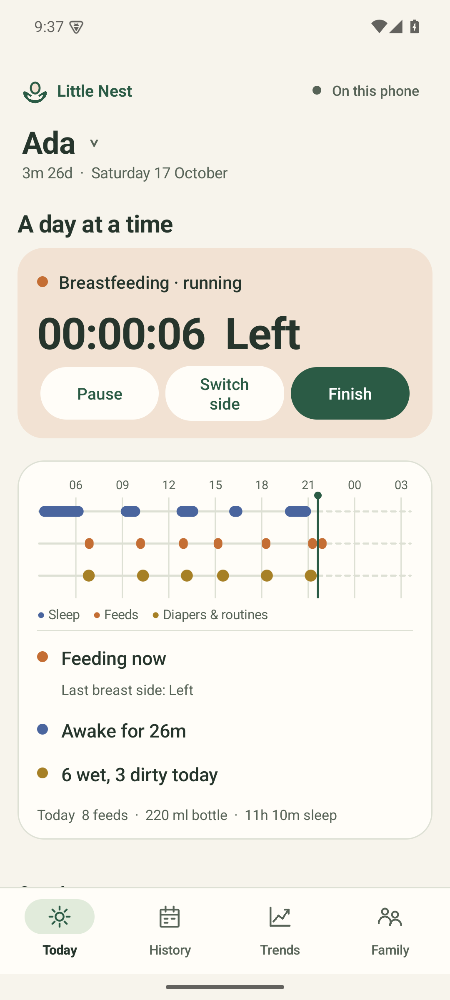](../docs/screenshots/timer.png) |
| A chick in a woven nest accompanies the day weave. Solid threads are logged care; dashed outlines are suggested times. | Larger, original activity symbols help distinguish each kind of care. Each tile shows how long ago it last happened. | Timers repeat their care symbol and keep large, steady numbers. |

| First use | Plan |
|:---:|:---:|
| [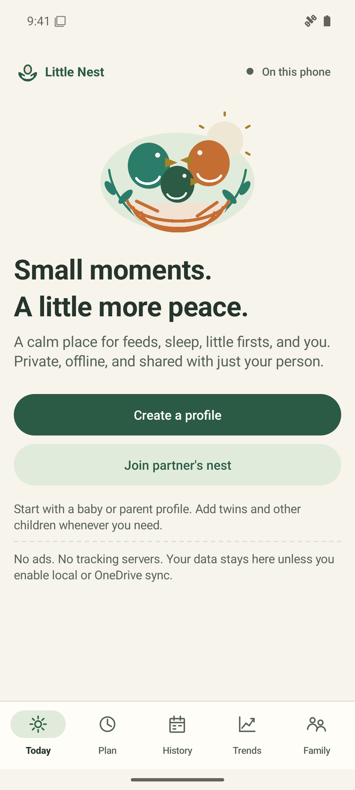](../docs/screenshots/welcome.png) | [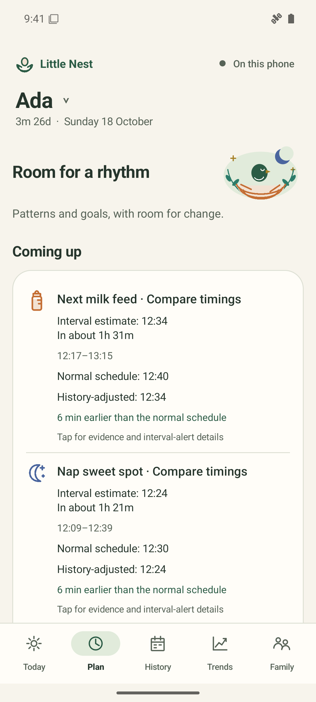](../docs/screenshots/plan.png) |
| A little family in a woven nest welcomes you. Create a profile or join your partner. | A quiet moonlit illustration leaves the estimates and safety guidance in focus. |

| Bottle logging | Nap planning details | History |
|:---:|:---:|:---:|
| [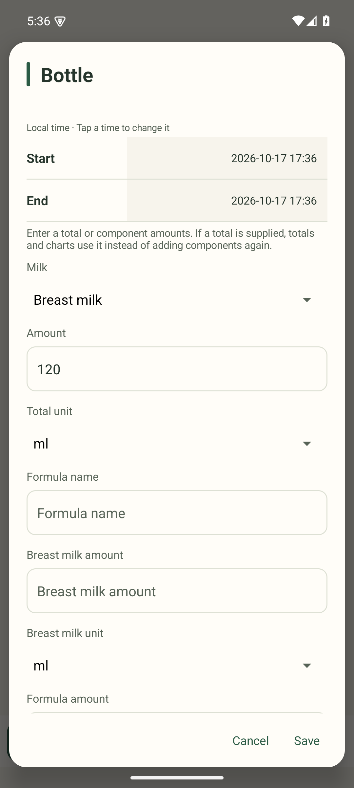](../docs/screenshots/bottle-form.png) | [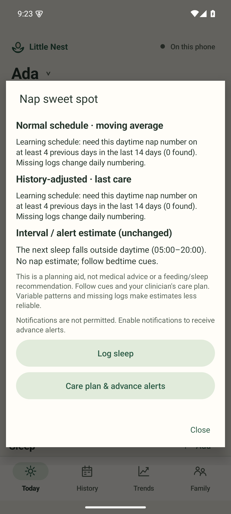](../docs/screenshots/care-details.png) | [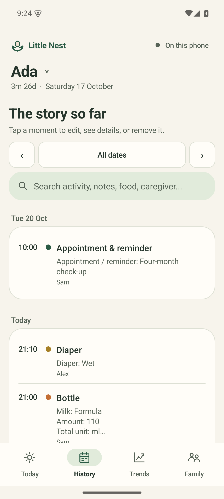](../docs/screenshots/history.png) |
| The form title uses the feed thread colour. Details are optional. | Every estimate explains where it came from, in plain words. | Entries are grouped by day, with a date picker and search. |

| Trends | Daily comparison | Growth |
|:---:|:---:|:---:|
| [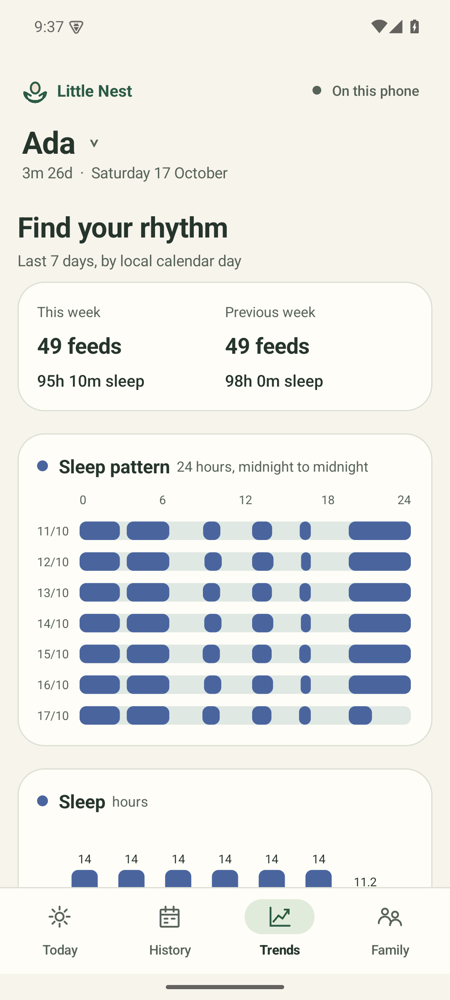](../docs/screenshots/trends.png) | [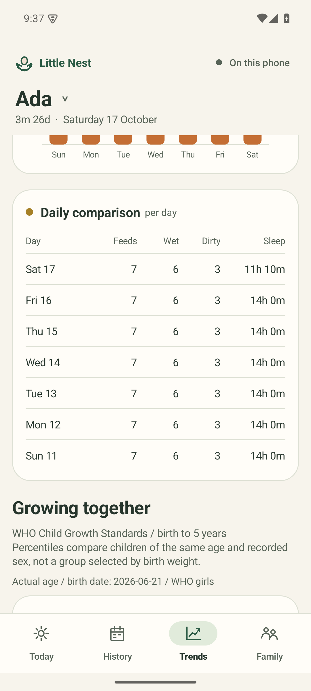](../docs/screenshots/trends-table.png) | [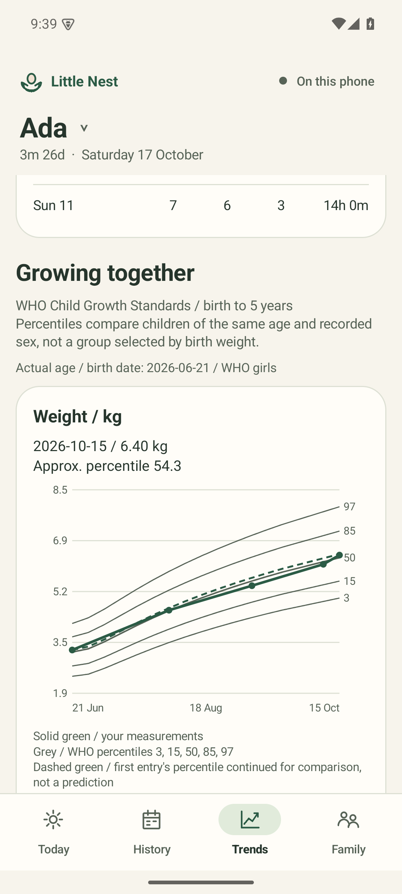](../docs/screenshots/growth.png) |
| This week against last week, then a 7-day sleep pattern. | One row per day for quick comparison. | Measurements against WHO reference curves (from version 1.7). |

| Family |
|:---:|
| [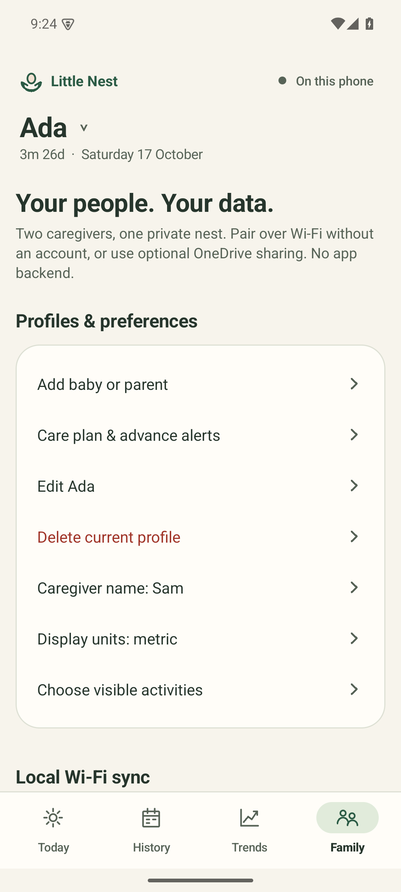](../docs/screenshots/family.png) |
| Profiles, caregivers, preferences and sync settings. |

## Dark (night)

The app follows the phone's dark-mode setting. The night palette is dim and
low-glare for 3 a.m. feeds, and keeps text contrast above 6:1.

| Today | History | Trends | Family |
|:---:|:---:|:---:|:---:|
| [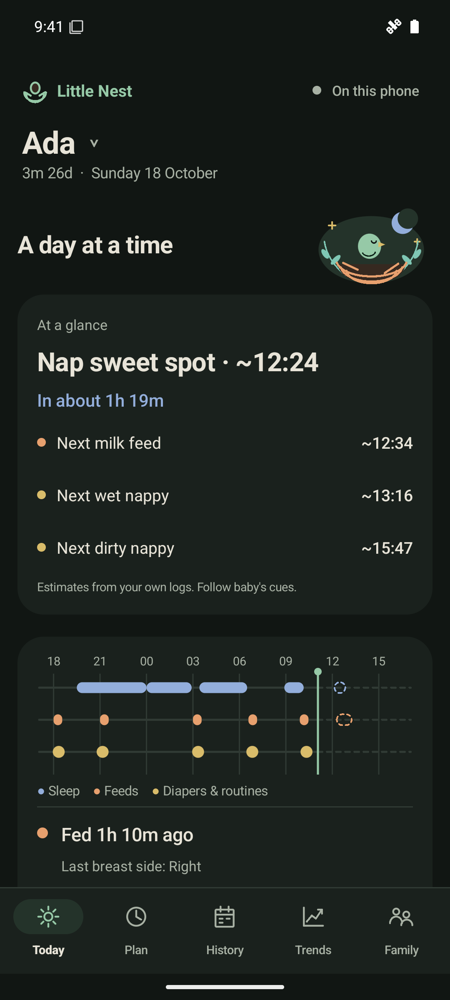](../docs/screenshots/today-dark.png) | [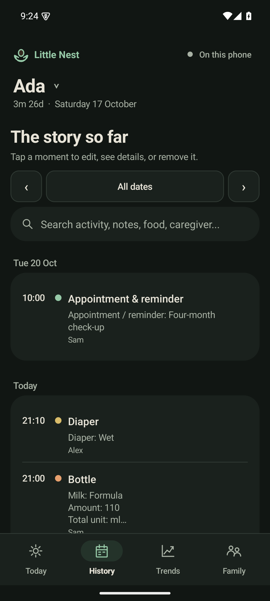](../docs/screenshots/history-dark.png) | [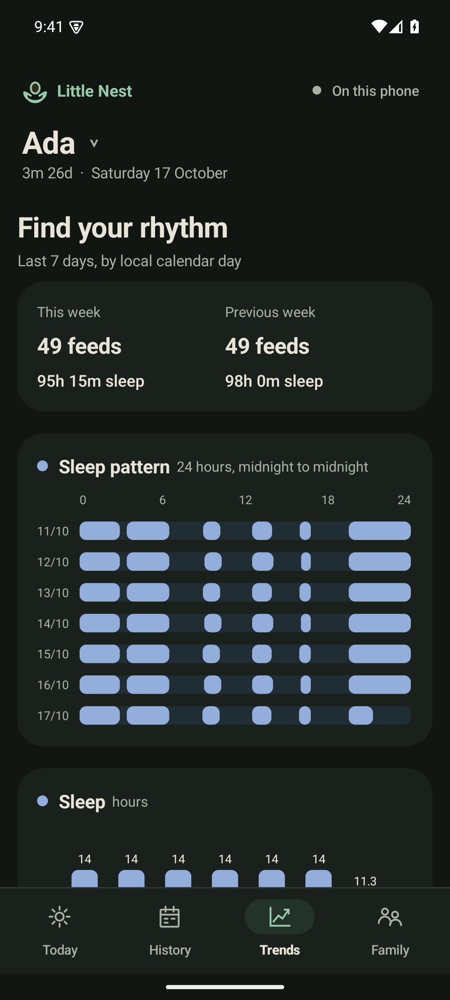](../docs/screenshots/trends-dark.png) | [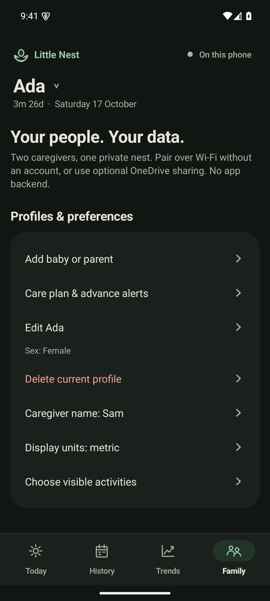](../docs/screenshots/family-dark.png) |

[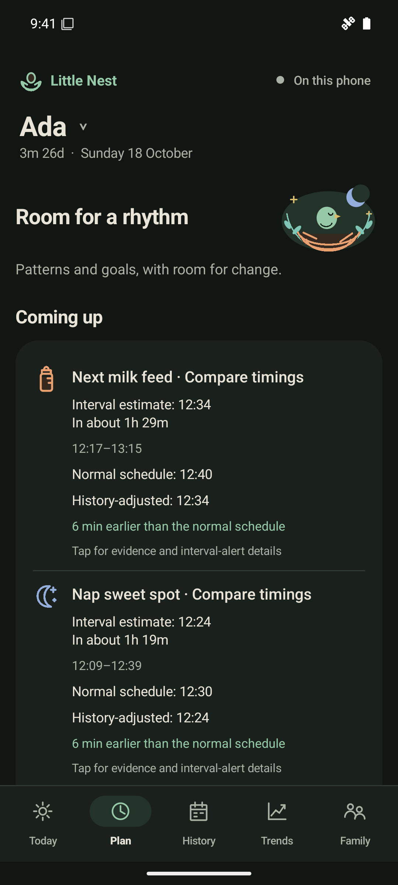](../docs/screenshots/plan-dark.png)

## Motion

Logging care on Today gives the chick one brief wing flutter and a rising
heart. Switching tabs gives the selected destination a gentle settle. These
native animations do not loop, download images or play sound, and both honor
Android's **Remove animations** setting. The artwork remains visible when
motion is disabled.

## Make new screenshots

Use a disposable test emulator, never a phone with real family data. The demo
data comes from `app/src/androidTest/java/app/littlenest/DemoData.java`. It only
runs when asked with `-e demo true`, so normal test runs skip it.

```bash
source scripts/env.sh
export ANDROID_SERIAL=emulator-5554   # your own test emulator
./gradlew :app:installDebug :app:installDebugAndroidTest
adb shell pm clear app.littlenest     # wipes the app's data on this emulator
adb shell am instrument -w -e class app.littlenest.DemoData -e demo true \
  app.littlenest.test/androidx.test.runner.AndroidJUnitRunner
adb shell am start -n app.littlenest/.MainActivity
adb exec-out screencap -p > docs/screenshots/today.png
```

For the night set, run `adb shell cmd uimode night yes` before capturing and
`adb shell cmd uimode night no` afterwards. Reload the demo data before the
night set if you started a timer, so it does not appear in other screenshots.
Keep the file names above so the README and this page stay correct.
